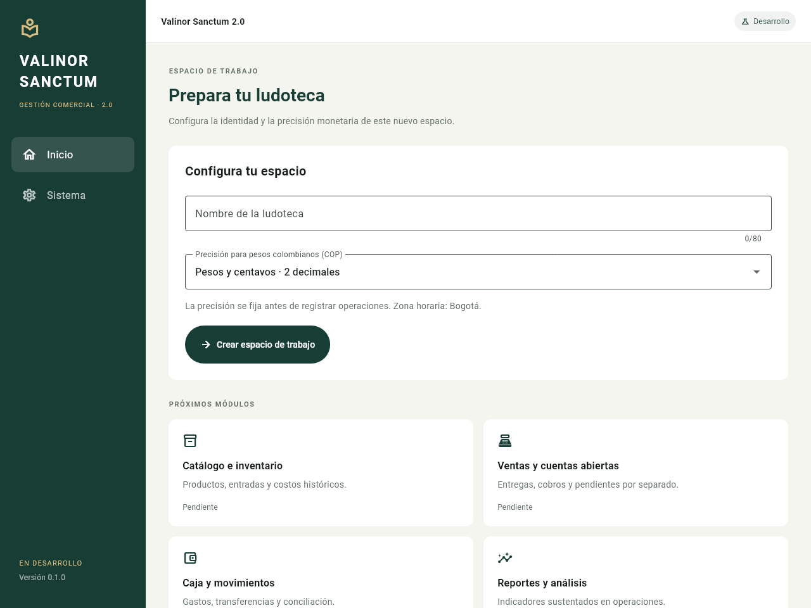

# Incremento 01 — Fundación Flutter y SQLite

Fecha: 18 de octubre de 2026, America/Bogota. Diseño aprobado expresamente por el propietario: «Sí lo apruebo».

Registro histórico del corte anterior. La instalación autorizada de C++, compilación nativa y comprobaciones posteriores se documentan en [validación Windows](11-validacion-windows.md).

## Resultado entregado

Implementada la primera estructura de la aplicación 0.1.0, con soporte de proyecto Windows y un núcleo ejecutado por el motor de pruebas Flutter. El bundle Dart y assets para windows-x64 se generó correctamente. **El ejecutable nativo .exe no se ha generado**: la máquina carece de las herramientas C++ de Visual Studio.

La aprobación del diseño habilitó implementación dentro de C:/proyectos/valinor_sanctum_2. Se mantuvieron los límites originales: ningún cambio en el POS actual, sus bases, su configuración o Git; ninguna migración de producción.

## Funcionalidad disponible

- Arranque con estados de carga, error recuperable y reintento.
- Interfaz de escritorio adaptable, navegación Inicio/Sistema y módulos futuros claramente pendientes.
- Creación explícita de un perfil vacío: nombre del negocio, COP, precisión elegida de cero o dos decimales y zona Bogotá. Persistencia verificada después de cerrar y reabrir SQLite.
- Diagnóstico real de ruta, identidad/versión del esquema, integridad, claves foráneas y checksums.
- SQLite propio v1, sin datos financieros, productos, saldos ni metas iniciales.
- Objetos Money exactos con escala y moneda, parser/formato es_CO, límites int64 y aritmética BigInt en intermedios.
- Distribución FIFO exacta por tramos; es una regla de dominio probada, todavía no un módulo de inventario operativo.
- Respuesta de error después de un commit de configuración: se conserva la fila confirmada, se evita anunciar éxito y el reintento recupera esa configuración sin duplicarla.
- Prevención de doble envío y de conexiones reemplazadas por reinicialización accidental.

La imagen proviene de una prueba de widgets con tipografías locales del SDK; no es una captura de un .exe Windows ejecutándose.

## Archivos y responsabilidades

| Grupo | Ubicación | Contenido |
|---|---|---|
| Entrada y UI | lib/main.dart; lib/app/sanctum_app.dart | Composición, arranque, formulario, diagnóstico y estados |
| Configuración/rutas | lib/core/infrastructure/app_config.dart; storage_paths.dart | Desarrollo/test y límites canónicos |
| Dinero y costo | lib/core/domain/money.dart; fifo_cost.dart | Reglas puras sin dependencia de widgets |
| SQLite | lib/core/infrastructure/database/ | Creación atómica, esquema propio y validación |
| Perfil | lib/features/workspace/domain/, application/, data/ | Entidad validada, controller y repositorio inyectado |
| Pruebas | test/unit/, integration/, widgets/, support/ | Dominio, persistencia real, fallos y presentación |
| Windows | windows/ y .metadata | Runner generado por Flutter; ejecutable valinor_sanctum_2 y título independiente |
| Dependencias | pubspec.yaml, pubspec.lock | Resolución bloqueada y reproducible |
| Herramientas | scripts/flutter.ps1; dart.ps1 | SDK/cachés/perfil temporal confinados, entorno restaurado al finalizar |
| CI | .github/workflows/windows.yml | Formato, análisis, pruebas y build Windows; no ejecutado remotamente |
| Diseño/documentación | AGENTS, README, documentos 04/05/08/10 y evidencia | Aprobación, estado y límites actuales |

No se copió código, credenciales, base ni instalador del POS original. Se generó el runner desde una plantilla nueva de Flutter. El archivo data/sqlite_workspace_store.dart queda incluido en Git: los directorios runtime /data y /tmp se ignoran solo desde la raíz, sin ocultar la capa de datos del código.

## Dependencias y reproducibilidad

- Flutter portable 3.47.7, revisión abaf9c523780a608bd46686fd5e53740a07077f8.
- Dart 3.13.5 incluido en ese SDK.
- Dependencias directas: path 1.9.1 y sqflite_common_ffi 2.4.4; flutter_lints 6.0.0 para desarrollo.
- La resolución contiene SQLite3 3.7.1 y sus hooks de assets nativos; no requiere un servidor.
- No se añadió Provider todavía: la inyección por constructor y ChangeNotifier bastan para esta fundación.
- El SDK, pub cache, perfil técnico y temporales están en .tooling y tmp, excluidos de Git. No se modificó PATH global ni se instaló un SDK global.

Las versiones se verificaron con el runtime y metadatos oficiales de [sqflite_common_ffi](https://pub.dev/packages/sqflite_common_ffi) y su [implementación oficial](https://github.com/tekartik/sqflite/tree/master/sqflite_common_ffi). Para reproducir el SDK en otro checkout: crear .tooling/flutter como repositorio vacío, fetch de la revisión fijada desde https://github.com/flutter/flutter.git y checkout detached de FETCH_HEAD; después usar los scripts locales.

## Almacenamiento real de este incremento

La ruta de desarrollo predeterminada es <repositorio>/data/development/<perfil>/sanctum2.sqlite3 cuando se ejecuta con herramientas. Un .exe de desarrollo dentro de build usará data/development junto al bundle. Las pruebas usan :memory: o <repositorio>/tmp/tests.

SANCTUM_WORKSPACE_ROOT es un define de compilación para trasladar el checkout de desarrollo/CI; por defecto apunta a C:/proyectos/valinor_sanctum_2. SANCTUM_DATA_ROOT y SANCTUM_PROFILE pasan por validación. SANCTUM_ENV solo acepta development/test. Producción está deshabilitada en este incremento.

Se rechazan rutas relativas/externas, nombres de perfil inseguros, namespace valinor.db, enlaces/alias detectados y el árbol del original antes de abrir SQLite. La capa de DB repite el control para proteger también aperturas directas; comprueba sidecars. Una DB desconocida, versión futura, deriva de esquema o checksum inválido se rechaza, sin reset ni downgrade.

El esquema contiene únicamente la fundación: schema_migrations, actors, app_profile, command_log, business_documents, ledger_accounts, journal_entries, journal_lines, cash_accounts y payment_methods. No crea usuarios, contraseñas ni cuentas monetarias al iniciar. Los triggers exigen balance al publicar un asiento y congelan documentos/asientos/partidas confirmados y respuestas de comandos.

Los checksums FNV-1a64 detectan cambios accidentales; no son firmas criptográficas ni protección contra un usuario con control del archivo. No hay migraciones desde versiones previas ni backup automático aún: v1 solo admite crear o reabrir su propio esquema.

## Verificaciones ejecutadas

| Verificación | Resultado real |
|---|---|
| dart format --output=none --set-exit-if-changed lib test | Correcto; cero archivos pendientes de formato |
| flutter analyze | Sin incidencias |
| Suite Flutter | 59 pruebas aprobadas y 3 omitidas; sin fallos |
| Pruebas de enlaces simbólicos omitidas | El host no permite crear los enlaces necesarios; no se afirma cobertura ejecutada de esos tres casos |
| Widgets a 1280x960 y 400x900 | Configuración, navegación y diagnóstico sin overflow después de correcciones |
| Vista previa | Renderizada e inspeccionada; fuentes e iconos cargados localmente |
| Persistencia de perfil | Crear, cerrar, reabrir; no se introducen registros financieros |
| SQLite | FK, enteros, balance, inmutabilidad, rollback, identidad/checksums y rechazo de esquemas ajenos/futuros |
| flutter build bundle --target-platform=windows-x64 --debug --no-pub | Correcto; kernel_blob.bin y assets generados |
| flutter doctor -v | Confirma Flutter/Dart locales; falta Visual Studio C++ |
| flutter build windows --release | Intentado; detenido por falta de toolchain Visual Studio |
| Workflow remoto | Creado, no ejecutado ni publicado |
| Integridad del original | Sus 163 archivos fuera de .git y los 28 archivos Git ajenos a refs/codex/turn-diffs conservan hashes; solo se observó recambio de dos referencias internas de capturas/checkpoints de Codex |

Los logs completos de la ejecución local están en tmp/logs (no versionados). La evidencia resumida se conserva en [increment-01.json](evidence/increment-01.json). No se ejecutó un .exe ni se validó instalación simultánea, cierre abrupto del proceso de escritorio o funcionamiento de módulos comerciales todavía inexistentes.

La igualdad de todo el árbol original, incluyendo las referencias internas de Codex, es falsa al comparar con el incremento documental previo: dos rutas bajo .git/refs/codex/turn-diffs fueron reemplazadas por otras dos. La evidencia conserva las rutas añadidas/eliminadas en lugar de ocultarlas. No se ejecutaron comandos para alterar o restaurar esas referencias; ramas, etiquetas, configuración, objetos y código permanecen iguales. La base externa del POS no se abrió ni inspeccionó. Para evitar el seguimiento de la carpeta original en incrementos posteriores conviene abrir el proyecto nuevo como ubicación de trabajo en la aplicación.

## Comandos locales

Desde C:/proyectos/valinor_sanctum_2:

~~~powershell
./scripts/flutter.ps1 pub get --enforce-lockfile
./scripts/dart.ps1 format --output=none --set-exit-if-changed lib test
./scripts/flutter.ps1 analyze
./scripts/flutter.ps1 test --reporter expanded
./scripts/flutter.ps1 build bundle --target-platform=windows-x64 --debug --no-pub
# Cuando se disponga del toolchain C++:
./scripts/flutter.ps1 run -d windows
./scripts/flutter.ps1 build windows --release
~~~

## Requisito pendiente para generar el .exe

Flutter requiere Visual Studio con C++ para compilar el runner nativo Windows. [Preparación oficial de Windows](https://docs.flutter.dev/platform-integration/windows/setup).

Se descargó el instalador oficial de Build Tools 2022 desde [Microsoft](https://aka.ms/vs/17/release/vs_BuildTools.exe) a .tooling/installers/vs_BuildTools.exe. Firma Authenticode válida de Microsoft Corporation; SHA-256 observado: 2A6AA7D94E38D457A4EB3930FC60056ECAB06865B2EB925E5275B8473A017583. **No se ejecutó el instalador**.

El script scripts/install-build-tools.ps1 muestra el plan sin instalar; solo con -Install lanza el workload VCTools recomendado, CMake/SDK según instalador, sin reiniciar automáticamente. Su directorio principal sería .tooling/visual-studio, pero Microsoft también instala componentes compartidos y modifica el registro fuera del proyecto. Esa acción requiere autorización específica porque el encargo limita las escrituras a la carpeta nueva. La aprobación del diseño no elimina esa restricción.

## Pendientes de producto

Catálogo, compras/proveedores, inventario persistente, ventas/cobros, cuentas abiertas, usuarios/permisos operativos, gastos/capital, arqueos, servicios/eventos, métricas, recomendaciones, planificación e importación permanecen pendientes. Las tablas de fundación no significan que esos casos de uso estén implementados. El siguiente incremento comercial comenzará por catálogo y recepción de inventario cuando quede verificado el entorno de escritorio.

No hay transición productiva, sincronización con el original ni datos reales de prueba.
