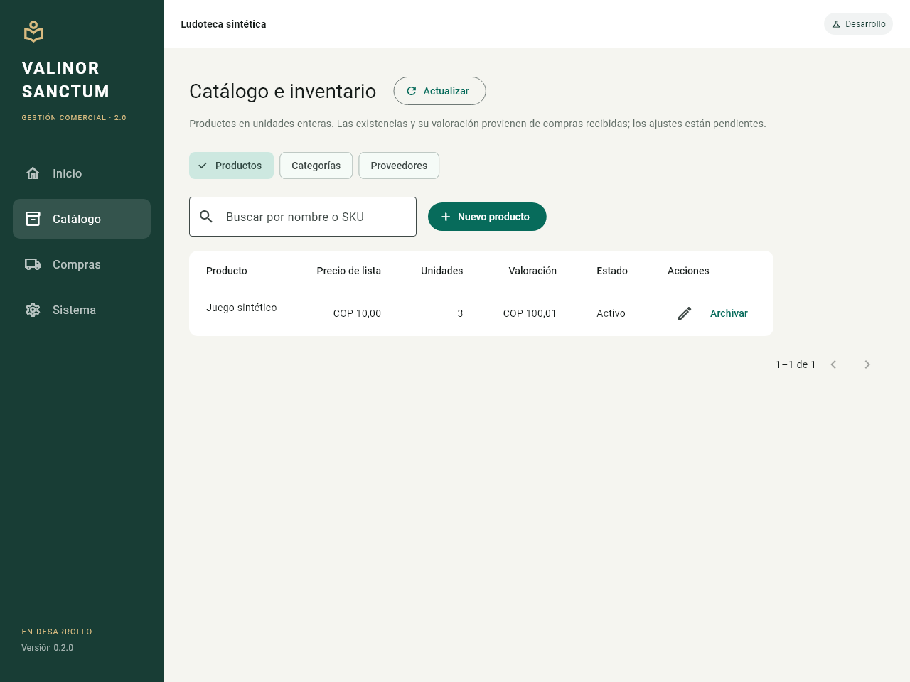
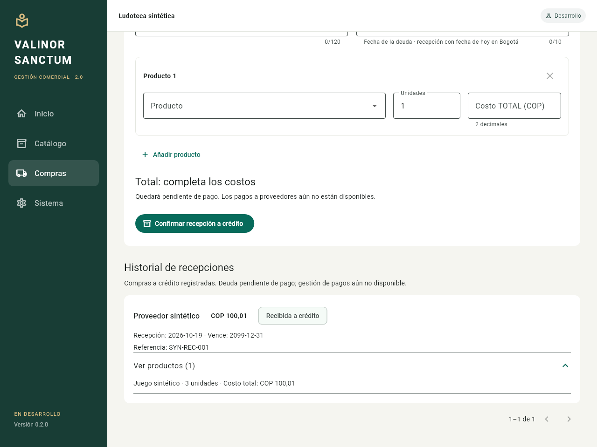

# Incremento 02 — catálogo y recepción de compras a crédito

Fecha: 19 de octubre de 2026, America/Bogota. Continuación autorizada mediante «Sube los cambios a git y continua». La fundación y su validación se subieron a origin/main en `45eb2bd` antes de iniciar este trabajo.

Versión 0.2.0, esquema SQLite v2. Es una entrega parcial de etapa 4A, exclusivamente para desarrollo y pruebas del repositorio nuevo. No reemplaza el POS original.

## Funcionalidad

- Crear, editar, archivar y reactivar categorías, proveedores y productos. Buscar por nombre/SKU, con listas paginadas.
- Productos en unidades enteras; SKU opcional único, categoría opcional y precio de lista en la moneda/escala del perfil. El precio no se utiliza como costo de inventario.
- Consultar cantidades y valoración reconstruidas desde movimientos y capas confirmados; no hay edición directa de saldos.
- Registrar mercancía recibida a crédito con proveedor, referencia opcional, fecha de vencimiento y varias líneas. El importe de cada línea es su costo total, sin divisiones ni redondeos ocultos. Una línea gratuita exige escribir cero; el total de la compra debe ser positivo.
- Confirmar documento, líneas, movimientos, capas de costo, deuda y asiento en una transacción. La compra incrementa inventario y proveedores por pagar; no crea un gasto ni un movimiento de caja.
- Consultar historial con nombres históricos de proveedor/productos, cantidades y costos de línea. Editar o archivar el catálogo no reescribe esas recepciones.
- Reintentar el mismo comando devuelve la respuesta confirmada; otro payload con la misma identidad se rechaza. Se conserva el JSON canónico además de su checksum para no depender solo de una huella corta.

La interfaz mantiene el formulario y un comando de resultado incierto al cambiar de sección. Bloquea sus campos y ofrece reintentar la misma compra. Solo limpia el formulario tras confirmar el resultado; una lectura fallida posterior informa que los datos visibles pueden estar desactualizados. Los nuevos IDs de catálogo se conservan durante el reintento del formulario.

## Modelo y límites

Se incorporaron categorías, catálogo, proveedores, compras/líneas, movimientos, capas y obligaciones. La primera recepción crea dentro de su transacción las dos cuentas internas necesarias y el actor de sistema «Operador local», sin saldos de ejemplo. Este actor identifica el proceso local; no equivale a una persona autenticada ni implementa permisos multiusuario.

Los importes y cantidades usan enteros de 64 bits con agregados BigInt. Se rechazan fechas inválidas, vencimientos anteriores a la recepción en Bogotá, duplicación de productos en una compra, catálogos inactivos y desbordamientos. Los triggers congelan historia confirmada, también ante INSERT OR REPLACE, y comprueban coherencia entre compra, stock, capas, deuda y asiento.

Los pagos a proveedores, ajustes, mermas, aperturas, ventas, devoluciones y consumo de capas FIFO siguen pendientes. Las capas de entrada preparan su costo histórico; este incremento no ejecuta salidas FIFO ni presenta métricas de rentabilidad.

El comando pendiente del cliente se conserva en memoria durante la sesión. No hay aún una bandeja persistente de solicitudes pendientes: ante cierre inesperado después de un resultado incierto, se debe revisar el historial al reabrir antes de crear otra compra. La idempotencia garantiza el reintento con el mismo commandId y payload; no identifica dos compras ingresadas con IDs nuevos. Una referencia de proveedor puede repetirse y no sustituye la identidad del comando. La recuperación integral ante cierres abruptos y la detección asistida de referencias repetidas quedan pendientes.

## Migración exclusiva de bases propias

Los statements y checksums v1 permanecen intactos. Antes de actualizar una base propia v1 se valida identidad, estructura conocida, historial, integridad y relaciones. SQLite genera un snapshot consistente mediante VACUUM INTO, incluyendo páginas comprometidas del WAL; no se copia el archivo vivo directamente. El respaldo se verifica en solo lectura y se compara su contenido con el de la base bajo la transacción exclusiva antes de aplicar v2. Si la base cambió entre ambos pasos, se rechaza la actualización y se puede volver a abrir para reintentar.

El respaldo queda en `backups/` junto a esa base, con nombre único. La migración y su metadata confirman juntas; una falla conserva v1. La aplicación anterior no puede abrir v2 y no se hace downgrade ni reset. No existe todavía una interfaz de restauración de respaldos.

Este proceso solo admite archivos dentro de `C:/proyectos/valinor_sanctum_2`, con los mismos controles de rutas, enlaces y namespaces. No abre, migra o sincroniza la base del POS original.

## Verificaciones y entrega

El verificador `tool/verify_inventory_flow.dart` crea una base sintética nueva bajo tmp. Comprueba recepción de dos productos, reintento sin duplicación, conservación de snapshots tras editar catálogo, stock/costo al reabrir, deuda, balance y ausencia de caja/gasto. El verificador `tool/verify_desktop_profile.dart` se conserva para la fundación v1 histórica.

Formato limpio en 34 archivos Dart, análisis sin incidencias y 114 pruebas aprobadas, con tres omitidas por falta de permiso del host para crear enlaces simbólicos. La suite incluye migración/preservación/respaldo con WAL, rechazo de drift, rollback comercial, dos conexiones con reintento tras bloqueo y regresiones frente a INSERT/UPDATE OR REPLACE de historia confirmada. Los formularios y el reintento incierto se ejercitaron en widgets, incluyendo navegación y ancho de 400 píxeles.

El [flujo sintético independiente](evidence/inventory-flow.json) pasó sus 19 comprobaciones con datos creados por el verificador. La compilación Windows de prueba terminó en 62,4 segundos. Al abrirla, navegar con teclado y leer su árbol accesible se observaron versión 0.2.0, dos productos con cantidades 3/2 y valoraciones COP 100,01/40,00, una recepción a crédito COP 140,01 con el nombre histórico del proveedor y los cuatro indicadores Correcto del esquema v2. Se cerró la ventana al terminar. Las [observaciones nativas de texto](evidence/inventory-native-observations.json) conservan ese alcance: el fixture se creó por CLI, no se registró una compra mediante el formulario nativo durante esta comprobación.

Estas imágenes proceden de RepaintBoundary y fuentes locales del SDK; no son capturas del ejecutable Windows. Los logs y bases de prueba no se versionan; la evidencia resumida sí.

La compilación final sin defines SANCTUM terminó en 57,0 segundos; su AOT difiere del smoke. El ejecutable extraído abrió el formulario vacío y mostró los cuatro indicadores Correcto, perfil development y esquema 2. Antes del arranque se observó v1 en la base propia de desarrollo; después, v2 y un respaldo v1 en su directorio backups. No se creó un perfil ni operaciones en esa base. Se cerró la ventana al terminar.

Entrega disponible:

- Ejecutable y dependencias: `dist/0.2.0/ValinorSanctum2/valinor_sanctum_2.exe`.
- ZIP: `dist/valinor-sanctum-2-0.2.0-windows-x64.zip`, 14.298.428 bytes, 17 archivos.
- SHA-256: `91241E4B3EE0771BD827CC2566E2908F841BC3BDB8A521D76473687BC6E6AF20`.
- [Evidencia resumida del incremento](evidence/increment-02.json).

Cada archivo extraído coincide por SHA-256 con su entrada del ZIP; no hay bases, perfiles runtime ni restos debug en el paquete. El ZIP conserva su hash después de abrir/cerrar el ejecutable. El workflow remoto se configuró, pero su resultado no se inspeccionó; los checks informados son locales.

La [verificación del original](evidence/original-check-increment-02.json) confirma 163 archivos de código/datos del repositorio original y 28 archivos Git sin cambios de contenido. Solo se observó recambio de las referencias internas de Codex, separado en el informe; no se escribieron ni restauraron. La base productiva externa nunca se abrió.

Comandos desde el repositorio nuevo:

~~~powershell
./scripts/dart.ps1 format --output=none --set-exit-if-changed lib test tool
./scripts/flutter.ps1 analyze
./scripts/flutter.ps1 test --reporter expanded
./scripts/dart.ps1 run tool/verify_inventory_flow.dart
./scripts/flutter.ps1 build windows --release --no-pub
./scripts/package-windows.ps1
~~~

El ZIP conserva motor Flutter, SQLite, runtimes C++ y assets, excluyendo bases y perfiles runtime. El almacenamiento sigue restringido al repositorio aprobado; producción está deshabilitada. La compilación de CI recibe un límite de checkout explícito para sus pruebas y artefactos, sin modificar la ruta local aprobada.
