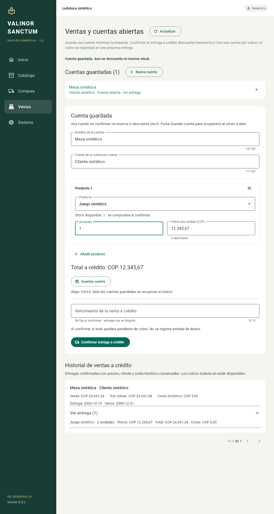

# Incremento 03 — cuentas abiertas y ventas a crédito

Fecha: 19 de octubre de 2026, America/Bogota. Continuación autorizada mediante «Entonces continúa», después de acordar cuentas y ventas primero y cobros en la siguiente entrega. Versión 0.3.0, esquema SQLite v3. Solo desarrollo/pruebas independientes.

Registro histórico: 0.4.0 añade cobros/abonos y esquema v4. Utiliza el acceso de inicio de la raíz para abrir la entrega vigente; un ejecutable 0.3.0 no abre una base migrada a v4.

## Funcionalidad

- Crear y editar cuentas con nombre, cliente, productos, cantidades enteras y precio unitario exacto. Guardar con Ctrl+S o con el botón; las cuentas guardadas se recuperan al reabrir. Los cambios de formulario todavía sin guardar se señalan y se conservan al cambiar de sección durante la sesión.
- Guardar una cuenta no reserva ni descuenta mercancía y no genera ingreso ni deuda. Se comprueba stock al confirmar la entrega.
- Confirmar una venta a crédito con vencimiento real. Venta, líneas con snapshots, salida de stock, costo FIFO histórico, cuenta por cobrar y libro financiero confirman en una única transacción.
- Consultar historial con cliente, cuenta, productos, cantidades, precios, costo, fecha y vencimiento históricos. Las ediciones posteriores del catálogo no reescriben esas ventas.
- Preparar la confirmación en disco antes de ejecutarla. Ante un resultado incierto queda bloqueada y se reintenta con la misma identidad, también tras cerrar/reabrir. Un rechazo determinista permite descartar esa solicitud y corregir la cuenta; una solicitud cancelada no puede confirmarse después.

Las ventas de este incremento quedan totalmente pendientes de cobro. No se crea un pago ni un movimiento de dinero. El nombre de cliente identifica esta cuenta por cobrar; no hay todavía un catálogo de clientes con agrupación automática por identidad.

## Integridad y decisiones

Los borradores tienen revisión optimista. Un guardado cuyo acuse se perdió puede repetirse con la misma cuenta, revisión esperada y contenido sin crear otra cuenta; un contenido distinto con revisión obsoleta se rechaza. La confirmación conserva su JSON canónico y el resultado; reintentar una venta confirmada devuelve ese mismo resultado incluso después de otras operaciones.

La política versionada `fifo-front-remainder-v1` consume capas según la secuencia de recepción. Dentro de cada capa se reparte su costo entero entre unidades y se asignan los residuos a las primeras unidades. Las asignaciones persistidas no se superponen, no exceden la capa y conservan exactamente su costo al agotarla. La función de distribución anterior de la fundación se conserva; no existían salidas comerciales previas.

Las compras y las ventas no pueden insertarse con fecha efectiva anterior a ventas ya confirmadas de sus productos. Una confirmación demorada puede ser rechazada si otra venta posterior del mismo producto se confirmó entretanto: hay que recuperar ese rechazo, corregir y preparar una solicitud actual. No se recalculan costos antiguos. Las comparaciones conservan microsegundos UTC, aunque Dart represente fechas con tres o seis decimales.

V3 añade tablas de ventas, cuentas, solicitudes, salidas, asignaciones y cuentas por cobrar sin reconstruir compras, capas ni obligaciones de proveedores v2. Las consultas de stock combinan entradas y salidas confirmadas. Los triggers validan coherencia y congelan historia, incluso ante INSERT/UPDATE OR REPLACE y durante el paso entre confirmar documento y confirmar asiento.

Las bases propias v1/v2 se validan y respaldan con un snapshot SQLite consistente antes de aplicar las migraciones pendientes en una transacción. Se compara el contenido del respaldo con la base bajo bloqueo. Un fallo de respaldo conserva la versión anterior; se rechazan esquemas futuros/alterados sin reset ni downgrade.

## Verificación

El verificador `tool/verify_sales_flow.dart` crea una base nueva bajo tmp y no acepta rutas existentes. El [flujo sintético](evidence/sales-flow.json) comprueba guardado/reapertura, recuperación de confirmación preparada, venta y reintentos antes/después de reapertura, stock/costo remanente, cuenta por cobrar, snapshots, balance y ausencia de cuentas monetarias inventadas. Deja una segunda solicitud preparada claramente sintética para observar la recuperación nativa.

Esta imagen proviene de una prueba de widgets con la aplicación y tema reales; no es una captura del ejecutable Windows. Los formularios y reintentos se verifican por widgets.

La suite completa pasó 157 pruebas; tres se omitieron porque el host no permite crear enlaces simbólicos. Formato limpio en 45 archivos Dart y análisis sin incidencias. Las pruebas incluyen migración de v1/v2 con respaldo y conservación de compras, reintentos recuperados, concurrencia, rollback comercial, precisión temporal de microsegundos, FIFO y protección SQL de historia confirmada. La revisión independiente detectó una revisión de formulario obsoleta tras desbloquear un rechazo; se corrigió y se probó tanto el flujo de corrección completo como la recuperación tras una lectura fallida.

El flujo sintético pasó sus 27 comprobaciones: compra de tres unidades, cuenta y confirmación recuperadas al reabrir, venta de dos unidades por COP 100,00 con costo histórico COP 66,68 y remanente de una unidad con costo COP 33,33. La cuenta por cobrar es COP 100,00; los reintentos no duplican la venta ni la salida. Son datos creados exclusivamente por el verificador.

La compilación Windows sintética terminó en 58,7 segundos. En su ventana se observaron la cuenta preparada recuperada, los datos bloqueados y el botón de reintentar, stock uno, historial con venta/CxC COP 100,00 y costo COP 66,68, y los cuatro indicadores Correcto del esquema v3. Se navegó por teclado y se cerró esa ventana. La operación comercial la creó el verificador CLI; no se ingresó una venta manualmente en el ejecutable durante esta observación. Véase [evidencia nativa sintética](evidence/sales-native-observations.json).

La compilación final sin defines de prueba terminó en 63,2 segundos y tiene un AOT distinto al sintético. Se publicó el bundle completo en la ruta estable conservando el anterior; la aplicación anterior se cerró antes de publicar. El acceso `Iniciar Valinor Sanctum.cmd` abrió la versión 0.3.0, formulario de configuración vacío y perfil development con esquema 3 y cuatro indicadores Correcto. Se creó un nuevo respaldo v2 de esa base propia. No se ingresó un perfil ni datos de negocio; se cerró la ventana al terminar. La captura nativa de imagen falló con `FrameArrived timed out`; las observaciones se hicieron por accesibilidad y teclado, registradas en [la evidencia de la entrega final](evidence/sales-final-observations.json).

## Entrega Windows

- Inicio estable: `Iniciar Valinor Sanctum.cmd` en la raíz.
- Copia versionada extraída: `dist/0.3.0/ValinorSanctum2/valinor_sanctum_2.exe`.
- ZIP: `dist/valinor-sanctum-2-0.3.0-windows-x64.zip`, 14.390.577 bytes y 17 archivos.
- SHA-256: `5E4DCCF5B64000F0DB62A9D30B0B23948CF631BBF31E845B73FAE320DD57FBC1`.
- [Evidencia resumida](evidence/increment-03.json).

Cada archivo del bundle vigente y de la copia versionada coincide por SHA-256 con su entrada del ZIP. El paquete no contiene bases ni perfiles runtime; su hash se conservó después de la prueba nativa. No se abrió ni modificó el POS original durante este incremento. Las comprobaciones informadas son locales; no se inspeccionó el resultado del workflow remoto.

## Pendientes

Cobros/abonos, pagos a proveedores, reservas, ajustes, devoluciones/reversas, caja/arqueo, informes generales, respaldo/restauración desde interfaz, usuarios e importación. La recuperación durable añadida se limita a confirmaciones de ventas; las compras conservan el reintento en memoria descrito en el incremento 02. No se certifica todavía recuperación integral ante corte de energía ni uso productivo.
