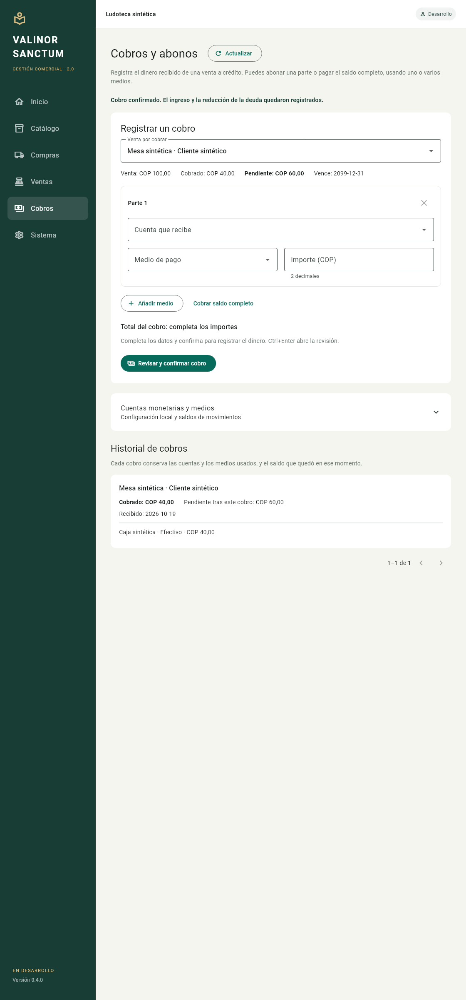

# Incremento 04 — cobros y abonos

Fecha: 19 de octubre de 2026, America/Bogota. Autorizado mediante «Vamos con el otro incremento entonces», reafirmado con «Continúa». Versión 0.4.0, esquema v4; desarrollo/pruebas en el repositorio independiente.

## Funcionalidad y límites

La sección Cobros configura cuentas monetarias locales y medios de pago. Una cuenta registra tipo, actividad y disponibilidad; el saldo se reconstruye desde movimientos confirmados y no existe un campo para inventar una apertura. El medio identifica cómo se recibió el dinero; no tiene saldo propio. No se procesan transferencias bancarias ni se conecta con servicios externos.

Se selecciona una venta por cobrar y se registra un abono o el saldo completo, repartido si hace falta entre varias cuentas y medios. La interfaz muestra importe recibido y pendiente resultante antes de confirmar y pide verificar que el dinero ya fue recibido. Ventas muestra los importes cobrados y pendientes actuales, sin alterar sus precios o costos históricos.

El cobro crea documento, partes con snapshots de cuentas/medios, aplicación a la cuenta por cobrar y asiento balanceado: debe dinero, haber clientes. No crea ingreso comercial, otra venta, costo ni salida de mercancía. Rechaza sobrepagos, importes no positivos o fuera de rango, pares cuenta/medio repetidos y catálogos inactivos.

La preparación se guarda en disco antes de ejecutar el cobro. Un resultado incierto mantiene los datos bloqueados y usa la misma identidad al reintentar, incluso tras cerrar/reabrir si quedó preparado. Solo los rechazos deterministas pueden descartarse para corregir. Si falla la lectura después de un resultado confirmado, se conserva el éxito y se bloquean nuevos cobros hasta recuperar los saldos. Los formularios aún sin preparar se conservan durante la sesión, sin afirmar que ya están guardados.

El historial conserva el saldo que quedó inmediatamente después de cada cobro y los nombres/códigos usados. Renombrar un catálogo no reescribe ese historial. Reintentar el primer abono después de otros pagos devuelve su resultado original, aunque el saldo actual sea diferente. Las cuentas configuradas conservan identidad y naturaleza; se pueden renombrar, archivar y reactivar.

## Persistencia e integridad

V4 añade solicitudes, cobros, partes y aplicaciones de deuda, reutilizando las cuentas y medios de la fundación. Statements y checksums v1–v3 permanecen intactos. La migración valida identidad, estructura e historial, genera un respaldo SQLite consistente y verifica su contenido bajo bloqueo antes de aplicar los cambios de forma transaccional. Se probó con una venta v3 real, su salida/costo FIFO y cuenta por cobrar, incluyendo datos comprometidos en WAL.

Solicitudes, dinero, deuda, asiento y resultado confirman juntos o se revierten. Cantidades monetarias y saldos usan enteros con agregados BigInt y controles int64; también se rechaza desbordar el saldo registrado de una cuenta. Las identidades se reservan entre compras, ventas y cobros antes de publicar resultados. Los triggers congelan historia ante UPDATE/DELETE/REPLACE y protegen el intervalo entre confirmar documento y confirmar asiento.

Un cobro no puede preceder a su venta ni al último cobro confirmado de esa deuda. Las comparaciones conservan microsegundos de UTC aunque el texto serializado tenga tres o seis decimales. Preparar no reserva saldo: una solicitud demorada puede ser rechazada si otro cobro consumió ese pendiente; debe recuperarse el rechazo y corregirse.

## Verificación

Pasaron 202 pruebas, con tres omitidas porque el host no permite crear enlaces simbólicos. Análisis sin incidencias y formato limpio en 55 archivos Dart. Se verificaron migraciones, dinero superior al rango exacto de double, desbordamiento de saldos, varias preparaciones compitiendo por una deuda, rollback por fallo de escritura, snapshots, cronología y defensas SQL.

Las cinco pruebas de widgets usan la aplicación y tema reales: configuración sin apertura, abono/pago final, recuperación tras cierre, acuse perdido con lectura fallida y corrección de rechazo. A 400 píxeles se comprobó la navegación y conservación del formulario sin confirmar.

Esta imagen es un render de widgets, no una captura del ejecutable Windows. El [verificador sintético independiente](evidence/collections-flow.json) pasó 27 comprobaciones: venta COP 100,00, abono COP 40,00, reapertura con pendiente COP 60,00 y pago restante repartido COP 25,00 a efectivo/COP 35,00 a móvil. Termina con pendiente cero, saldos registrados COP 65,00/COP 35,00 y el mismo stock/costo e ingreso comercial que antes de cobrar. Los reintentos conservan su resultado y no duplican dinero.

La compilación Windows sintética terminó en 60,8 segundos. En su ventana se observaron los cobros de COP 40,00 y COP 60,00, su reparto histórico, ausencia de ventas pendientes y saldos registrados COP 65,00/COP 35,00. El catálogo mostraba los nombres nuevos y el historial conservaba los anteriores. El diagnóstico mostró cuatro Correcto y esquema v4. Se navegó por teclado y se cerró la ventana. Los cobros fueron creados por CLI; esta observación no se presenta como entrada manual nativa de pagos. Véase [evidencia nativa sintética](evidence/collections-native-observations.json).

La compilación final sin defines de prueba terminó en 61,1 segundos, con AOT distinto al sintético. Se publicó el bundle completo en la ruta estable, conservando el anterior. El acceso de inicio abrió 0.4.0, formulario de configuración vacío, perfil development, esquema 4 y cuatro indicadores Correcto. La base propia generó un nuevo respaldo v3; no se ingresó perfil ni datos de negocio y se cerró la ventana. Véase [observación final](evidence/collections-final-observations.json).

## Entrega Windows

- Inicio estable: `Iniciar Valinor Sanctum.cmd` en la raíz.
- Copia versionada extraída: `dist/0.4.0/ValinorSanctum2/valinor_sanctum_2.exe`.
- ZIP: `dist/valinor-sanctum-2-0.4.0-windows-x64.zip`, 14.494.599 bytes y 17 archivos.
- SHA-256: `E8042C7F598B7641EC71792B081664405FDBC0B0C823B8E5E6E147D4A7EE35DB`.
- [Evidencia resumida](evidence/increment-04.json).

Los 17 archivos de la copia versionada y del bundle vigente coinciden por SHA-256 con su entrada del ZIP. No contiene bases ni perfiles runtime y su hash no cambió después de la prueba nativa. El POS original y sus bases no se abrieron ni modificaron durante este incremento. No se inspeccionó el resultado del workflow remoto.

## Pendientes

Pagos a proveedores, aperturas, gastos, transferencias, capital, sesiones/arqueos de caja, ajustes de inventario, reversas/devoluciones y respaldo/restauración desde interfaz. Las compras mantienen el límite de reintento en memoria del incremento 02. No se certifican todavía recuperación integral frente a corte de energía, importación ni uso productivo. Las comprobaciones informadas son locales.
